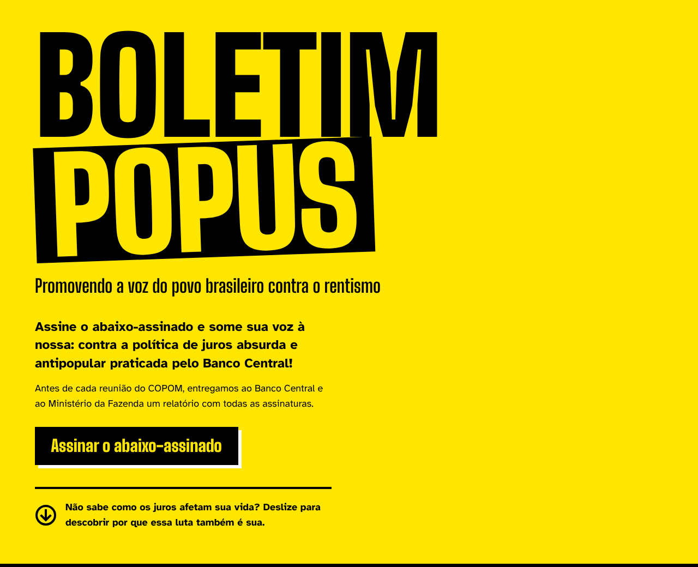
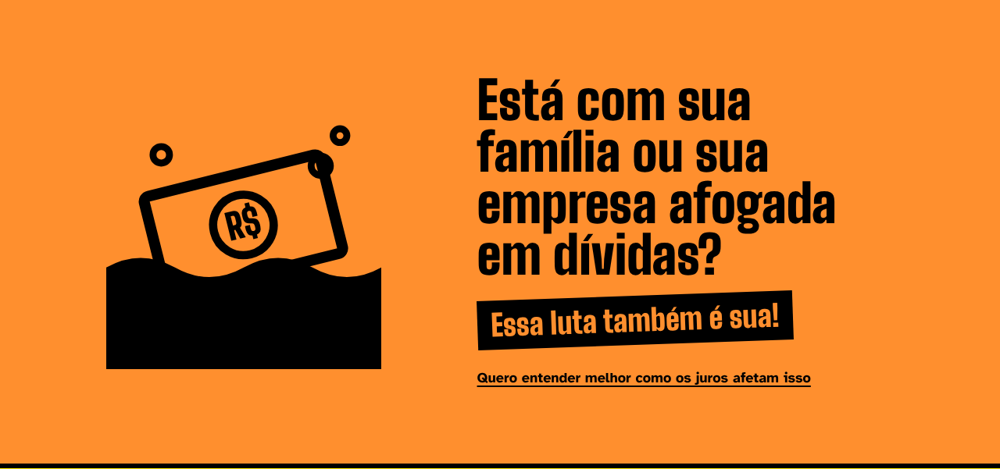
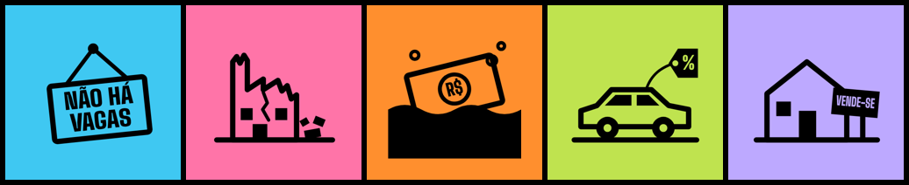
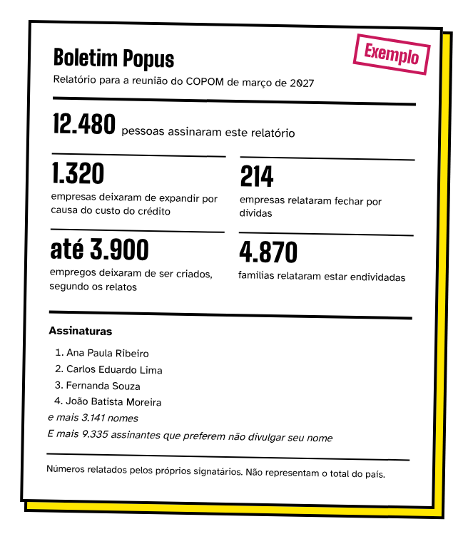

<p align="center">
  
</p>

# Boletim Popus

**Promovendo a voz do povo brasileiro contra o rentismo.**

O Boletim Popus é um abaixo-assinado permanente contra a política de juros do Banco Central. Antes de cada reunião do COPOM, as assinaturas e os números agregados dos relatos viram um relatório em PDF, entregue ao Banco Central e ao Ministério da Fazenda e publicado no site.

É um contraponto ao [Boletim Focus](https://www.bcb.gov.br/publicacoes/focus): o Focus reúne as projeções dos economistas do mercado; o Popus reúne a voz de quem toma crédito.

> **Status:** protótipo. A landing page, o formulário de assinatura, o questionário do relato e a minuta da política de privacidade estão prontos, ainda sem backend: os formulários simulam o envio e não gravam nada. O MVP vai coletar assinaturas e relatos desde o início. O primeiro relatório oficial está previsto para a reunião do COPOM de 16–17 de março de 2027.

## A ideia

A landing page é uma sequência de cartazes no estilo lambe-lambe, um por tema, cada um com um ícone, uma pergunta e o refrão *"Essa luta também é sua!"*. O objetivo é mostrar a quem já se incomoda com os juros que o problema chega no emprego, na empresa, nas dívidas, no carro e na casa.

<p align="center">
  
</p>

<p align="center">
  
  <br>
  <sub>Emprego · Empresas · Endividamento · Carro · Moradia</sub>
</p>

## Como funciona

| Passo | O que acontece |
|---|---|
| 1. Você assina | Em `/assinar`, com nome, e-mail e CPF; o estado (UF) é opcional. Leva menos de 1 minuto. O CPF garante uma assinatura por pessoa e nunca é publicado. |
| 2. Você conta sua história (opcional) | Logo depois de assinar, em `/conte-sua-historia`, você pode responder um questionário curto sobre como os juros afetaram sua vida, sua família ou sua empresa nos últimos 12 meses. São telas curtas, uma por tema, e só aparecem as que se aplicam a você. Dá para pular qualquer etapa. |
| 3. Você confirma pelo e-mail | Sem o clique no link de confirmação, nem a assinatura nem o relato contam. |
| 4. Sua assinatura vai no relatório | A assinatura vale para todos os ciclos até ser retirada. O nome só aparece se a pessoa autorizar; caso contrário, ela entra apenas na contagem. O relato entra só como número agregado. |

Só quem assina pode fazer o relato: assim, cada número do relatório se apoia em uma assinatura com CPF único e e-mail confirmado.

## O relatório

Cada reunião do COPOM gera um relatório, congelado 8 dias antes da reunião. Ele traz o total de assinaturas (com as novas do ciclo em destaque) e o número de assinaturas por estado, números agregados dos relatos sobre o impacto dos juros, contexto com dados oficiais, a metodologia e um anexo só com os nomes de quem autorizou a publicação.

<p align="center">
  
  <br>
  <sub>Modelo com números fictícios, como aparece na landing page.</sub>
</p>

Os números são **relatos dos signatários**, de uma amostra autosselecionada, e nunca são apresentados como estatística do país. O sujeito das frases é sempre o signatário ("x signatários relataram o fechamento de suas empresas"). O relatório diz o que a validação garante (uma assinatura por CPF com formato válido e e-mail confirmado) e nunca afirma que o CPF foi verificado na Receita Federal.

### Métricas

Cada pergunta do relato existe para produzir um número publicado:

- **Eventos**, em duas visões ("desde a primeira edição" e "desde a última reunião do COPOM"): empresas fechadas, em recuperação ou que renegociaram dívidas para não fechar, e os postos de trabalho nas que fecharam ou entraram em recuperação; investimentos adiados ou cancelados e os empregos que teriam sido criados; compras adiadas de veículo, imóvel ou reforma; crédito tomado fora de banco; nome negativado.
- **Situação**, como retrato dos últimos 12 meses: contas em atraso, capacidade de pagá-las, parte da renda que vai para parcelas de dívidas (em faixas compatíveis com a PEIC/CNC) e tipos de dívida.

O relato não pede valores em reais nem a renda, e não tem texto livre. O questionário completo será publicado na metodologia.

### Ciclo

| Quando | O quê |
|---|---|
| D-14 | Lembrete de que é possível rever ou retirar a assinatura (só para quem aceitou lembretes) |
| D-8 | Congelamento: snapshot imutável das assinaturas ativas e dos relatos aprovados |
| D-7 | Geração do PDF e do hash SHA-256, protocolo no Banco Central e no Fala.BR, envio ao Ministério da Fazenda, publicação no site |
| D+1 | E-mail com a decisão do COPOM (opcional) |

## Privacidade

Assinar um abaixo-assinado revela uma opinião política, que a LGPD trata como dado sensível. Por isso, a base inteira é tratada como sensível:

- o consentimento da assinatura é um texto em destaque junto ao botão; publicar o nome e receber lembretes ficam em caixas separadas e não marcadas; o relato tem consentimento próprio. Todos são registrados com data, versão do termo e IP;
- CPF guardado só como HMAC, com a chave fora do banco; nunca publicado nem enviado a terceiros. O CNPJ, opcional no relato, recebe o mesmo tratamento;
- a tela depois do envio é igual para todos, para não revelar se um e-mail ou CPF já assinou. Se um CPF já cadastrado aparecer com outro e-mail, a assinatura nova fica suspensa e o e-mail antigo recebe um alerta;
- só a UF é pedida, sem município, telefone, endereço ou renda;
- assinaturas e relatos não confirmados por e-mail são apagados após 7 dias; retirar a assinatura apaga também o relato;
- relatos publicados só como números agregados;
- gestão da assinatura sem senha, por link mágico de uso único, com retirada a qualquer momento;
- sem ferramentas de análise de audiência, pixels, publicidade ou rastreamento de e-mails;
- fontes servidas pelo próprio site, sem Google Fonts.

A minuta da política está em [`privacidade.html`](privacidade.html) (versão 0.2, em revisão jurídica, ainda não em vigor).

## Estrutura do repositório

```
.
├── index.html                # Landing page
├── assinar.html              # Formulário de assinatura e tela pós-envio
├── conte-sua-historia.html   # Questionário do relato, em etapas
├── privacidade.html          # Minuta da política de privacidade (v0.2)
└── docs/
    └── img/                  # Imagens deste README
```

Cada página é um arquivo só, com HTML, CSS e JS. Para ver o protótipo, basta abrir `index.html` no navegador e seguir pelo botão de assinar. Os formulários validam os campos e simulam o envio; os pontos de integração com o backend estão marcados no código com `BACKEND:`. Para ver a tela final do relato de quem já confirmou o e-mail, abra `conte-sua-historia.html?confirmado=1`. Links para páginas que ainda não existem mostram um aviso de "em construção" (atributo `data-em-breve`).

## Stack planejada

- **Backend:** Django + PostgreSQL, com o painel administrativo para revisar relatos fora do comum e acionar os ciclos.
- **Frontend:** templates do Django com um pouco de HTMX, reaproveitando o HTML e o CSS das páginas do protótipo.
- **PDF:** WeasyPrint ou Typst, gráficos com matplotlib.
- **E-mail:** Brevo, com rastreamento de aberturas e cliques desligado.
- **Proteção:** Cloudflare e Turnstile.
- **Design:** Big Shoulders Display e Atkinson Hyperlegible (SIL OFL), cores em variáveis CSS.

## Roteiro

| Fase | Período | Entregas |
|---|---|---|
| 0. Protótipo e fundamentos | nov–dez 2026 | Landing page, especificação, métricas do relatório e questionário do relato, metodologia, política de privacidade, revisão jurídica |
| 1. MVP de assinatura e relato | dez 2026–jan 2027 | Formulário de assinatura com confirmação por e-mail e formulário de relato (front-end feito), página Meus Dados, painel administrativo |
| 2. Relatório | jan–fev 2027 | Geração do PDF, ciclo de teste na reunião de 26–27 de janeiro, já com relatos reais |
| 3. Conteúdo e divulgação | fev–mar 2027 | Biblioteca, Compartilhe, artigos "Entenda" |
| Primeiro relatório | mar 2027 | Entrega antes da reunião de 16–17 de março |
